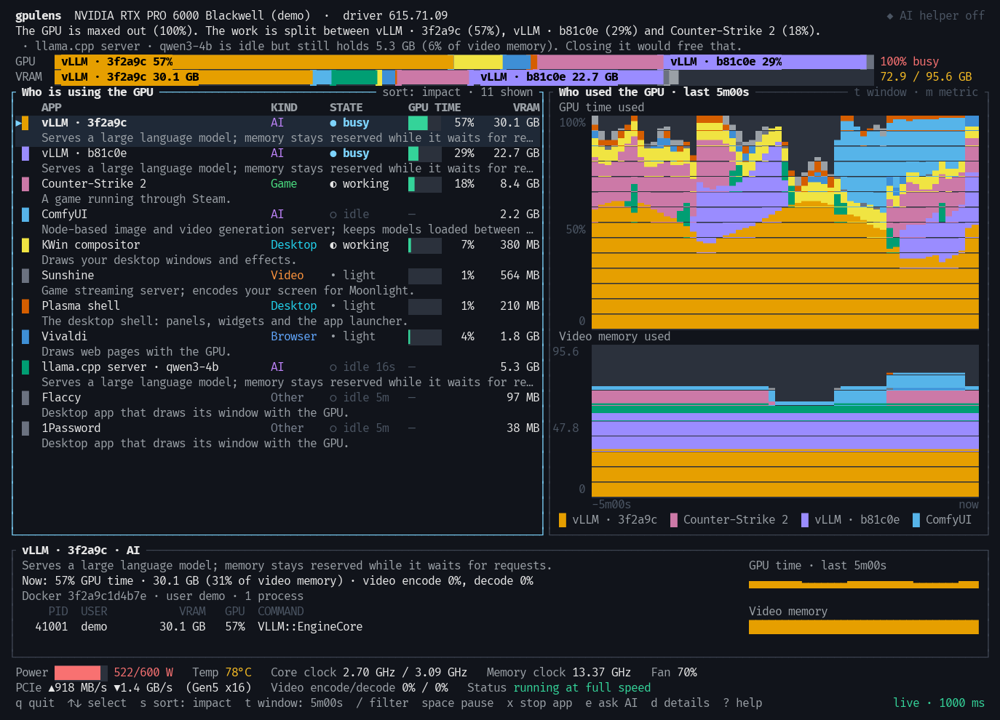

# gpulens

[](https://github.com/guitaripod/gpulens/releases)
[](https://github.com/guitaripod/gpulens/actions/workflows/ci.yml)
[](LICENSE)
[](#project-status)
[](https://www.rust-lang.org)
[](#project-status)

A GPU monitor that answers one question in plain language: **what is using my GPU right now, and why?**

nvtop and nvidia-smi list process IDs and numbers. gpulens groups processes into the apps you actually know (a game, your browser, a language model server, the desktop), colours each app consistently across every view, and writes a sentence about the situation. An optional small local language model names programs it has never seen and phrases the summary in friendlier words.



## Project status

**0.1.0, an early release.** Everything below marked verified was run on one machine (an RTX PRO 6000 Blackwell, driver 615, KDE Wayland). Expect rough edges on hardware I have not seen, and please open an issue when you find one.

```text
  ███████▒▒▒▒░░░   7 verified   ·   4 tested with fakes   ·   3 not there yet
```

| | Area | State | What that means |
| :-: | --- | --- | --- |
| ✅ | NVIDIA monitoring through NVML | Verified | RTX PRO 6000 Blackwell on driver 615 |
| ✅ | Per-app GPU time and memory | Verified | checked against a real, busy GPU |
| ✅ | Plain-language headline and findings | Verified | numbers come from readings and are checked before any AI rewrite is shown |
| ✅ | Bars, history chart, detail pane, stop action | Verified | including a square window and 60×14 up to wide terminals |
| ✅ | Calm layer: steady rows, smoothed numbers, glides | Verified | on a real desktop, rows moved several times less than with it off |
| ✅ | Colour, 256, 16, no colour and ASCII output | Verified | render tests at many window sizes |
| ✅ | AI helper with llama.cpp and llama-swap | Verified | Qwen3 4B Instruct, structured JSON in about a tenth of a second |
| 🟡 | AI helper with Ollama, LM Studio or vLLM | Tested with fakes | discovery and requests run against mock servers, not the real thing |
| 🟡 | More than one GPU | Tested with fakes | tabs and per-GPU colours are unit tested; not run on a real multi-GPU box |
| 🟡 | GPUs without per-process data (older cards, MIG, vGPU) | Handled in code | says so in the headline instead of guessing; not run on one |
| 🟡 | Containers | Handled in code | hidden processes show as "process 1234"; not run inside one |
| ⬜ | Unified-memory systems | Not handled yet | |
| ⬜ | AMD, Intel and Apple GPUs | Not supported | NVML only |
| ⬜ | macOS and Windows | Not supported | Linux only |

✅ verified on real hardware · 🟡 written and tested, never run on the real thing · ⬜ not there yet

**By the numbers:** 390 tests and clean `clippy`, builds on Rust 1.88 and current stable, about 0.5% CPU while still and under 2% while animating, one 5 MB binary.

**Next:** a real multi-GPU run, an AUR package, publishing to crates.io, unified-memory support. See [CHANGELOG.md](CHANGELOG.md) for what changed and [CONTRIBUTING.md](CONTRIBUTING.md) if you want to help.

## What you get

- **A story line.** "The GPU is busy (62%). vLLM is doing most of the work (56%), with KWin on the side." Always computed from real readings, never guessed.
- **Two stacked bars.** GPU time and video memory, split by app, with the app's name inside its segment. One colour per app everywhere.
- **Who is idle but hogging memory.** Apps that do nothing yet hold gigabytes are called out, with how long they have been idle.
- **A history chart.** Stacked by app over the last 1 minute, 5 minutes, 15 minutes or hour, so you can see *when* something used the GPU, not only that it does now. Apps that have left still show in the legend.
- **Plain descriptions.** Every row says what the program is: "Serves a large language model; memory stays reserved while it waits for requests."
- **Grouping that makes sense.** Chromium helper processes, Steam's many processes or two vLLM containers become one row each, with the container id as the tie-breaker.
- **Hardware at a glance.** Power against limit, temperature, clocks, PCIe traffic, video encoder and decoder load, and a plain-language reason if the card is being held back.
- **Safe actions.** Stop an app from the list. It asks first (an explicit `y`; Enter does nothing), never offers desktop or system apps, never touches another user's processes unless you run gpulens as root, and checks the process is still the one you saw.
- **Scriptable.** `gpulens snapshot --json` prints the same picture for scripts and agents.

NVIDIA GPUs only for now (through NVML). Linux only.

## Install

```sh
git clone https://github.com/guitaripod/gpulens
cd gpulens
scripts/install-local.sh        # cargo install --path . --locked, then verifies the installed version
```

Needs a Rust toolchain (1.88 or newer) and the NVIDIA driver. The driver library is loaded at run time, so the binary starts on any machine and tells you what is missing.

Shell completions: `gpulens completions bash|zsh|fish`.

## Use

```sh
gpulens                 # the interface
gpulens --demo          # a scripted fake GPU, no hardware needed
gpulens snapshot        # one text report (also what you get when piping the output)
gpulens snapshot --json # the same, machine readable
gpulens setup           # connect a small local language model (optional)
gpulens doctor          # check everything gpulens relies on
```

| Key | Action |
| --- | --- |
| `↑` `↓` or `j` `k`, mouse wheel or click | choose an app |
| `s` | sort by impact, memory, name or kind |
| `t` | history window: 1m, 5m, 15m, 1h |
| `/` | filter by name, kind or command |
| `d` / `a` | show or hide the one-line explanations / AI wording or plain wording |
| `space` | pause the picture (sampling continues; up to the history length is kept and replayed on resume) |
| `+` `-` | sample faster or slower (restarts the history, since frames at different rates cannot be mixed) |
| `x` | stop the chosen app (asks first) |
| `e` | ask the AI helper why the chosen app is using the GPU |
| `Tab` or `[` `]` | next or previous GPU |
| `?` | help |
| `q` | quit |

Colours follow the terminal's capabilities (truecolor, 256, 16, or none with `NO_COLOR` or `--no-color`) and use a colour-blind-safe palette. `--ascii` draws with plain characters for terminals without Unicode. The layout adapts down to 60×14.

## Why it stays calm

Raw GPU readings twitch every second. gpulens is built so the picture does not:

- Numbers are smoothed over about a second and a half, and the bars glide between readings instead of jumping.
- Rows keep their order. Apps that have been using the GPU lately come first, ranked on a slow average, then the idle ones by memory. An app only moves up when it is clearly ahead of the one above it, so similar apps do not trade places.
- State labels (busy, working, light, idle) need a clear margin to climb and a few seconds below it to fall.
- The headline and findings only change wording after the new wording has held for a moment. The room they occupy grows at once when needed but only shrinks after half a minute of quiet, so the panels below them rarely shift.
- Bar segments keep their colour order. The history chart is anchored to absolute time, so it scrolls instead of shimmering.
- An app that exits stays in the list for a few seconds, shrinking and marked "exited", instead of its row vanishing.

Set `calm = false` or `animate = false` in the config if you prefer raw readings or no motion.

## What the numbers mean

- **GPU time** per app is NVML's per-process SM utilisation, averaged over the sampling window. A process that did nothing reports nothing, so it shows as idle. The total can be lower than the card's overall busy figure; the difference is shown as "unclaimed" (other users, containers whose processes the driver cannot attribute, driver work).
- **VRAM** per app is what the driver reports for each process. The card also reserves some memory for itself, shown as "reserved".
- **Encoder and decoder** load is shown when an app uses the video engines (recording, streaming, transcoding), even if its shader load is zero.
- Inside a container the driver only reports processes visible to the host, so run with `--pid=host` if the list is empty. Processes gpulens cannot read in `/proc` show as "process 1234".
- Some GPUs (older cards, MIG, virtual GPUs) cannot report per-process utilisation. gpulens says so in the headline and shows memory only, rather than inventing figures. Unified-memory systems are not specially handled yet.
- The driver reports each process roughly once a second, and only while it is doing something. gpulens keeps the last figure for a moment so fast sampling does not flicker.

## The AI helper

Entirely optional, and off until you run `gpulens setup`. It talks to a model on your own machine through any OpenAI-compatible server (llama.cpp's `llama-server`, llama-swap, Ollama, LM Studio, vLLM).

What it does:

1. **Names unfamiliar programs** once. The answer is checked, cached in `~/.cache/gpulens/learned.json`, and never asked again. Built-in rules and your own catalog always win over it.
2. **Rewrites the headline** in friendlier words when the situation changes. A rewrite is discarded if it contains a number that is not in the readings, and it is only shown while it still describes the current situation. Press `a` to compare with the plain wording.
3. **Explains an app** on request (`e`).

What it does not do: it never sees your screen or files. For unfamiliar programs it sends the executable path and a scrubbed command line (secrets and long tokens removed, home directory shortened) to the server you chose, which is local unless you configured otherwise. It is never started or loaded behind your back: `setup` asks before using a model that is not already loaded, because starting one can push other models off the GPU. All calls run on a background thread with timeouts and a circuit breaker; if the server is slow or gone, the interface does not notice.

`gpulens setup` finds servers on the usual local ports (or `--url`), picks the best small instruction model (embedding, reranking and thinking models are skipped), runs a real structured-output test, names the unfamiliar programs currently on your GPU, and writes the config. `--dry-run` shows what it would do.

## Configuration

`~/.config/gpulens/config.toml` (override with `--config` or `GPULENS_CONFIG`). Every key is optional.

```toml
interval_ms = 1000        # 250 to 10000
history_secs = 3600
window_secs = 300         # starting history window
ascii = false
allow_kill = true         # set false to remove the stop action entirely
calm = true               # smooth readings, keep row order steady, debounce labels and wording
animate = true            # glide bars and numbers between readings (false for reduced motion)

[llm]
enabled = true
base_url = "http://127.0.0.1:8081"
model = "qwen3-4b-instruct-gguf"
api_key_env = "MY_KEY_VARIABLE"   # name of an environment variable, never the key itself
timeout_secs = 30
classify = true
narrate = true
narrate_cooldown_secs = 20
```

Your own names for programs go in `~/.config/gpulens/catalog.toml` and take priority over everything else:

```toml
[[app]]
match = "python3 ComfyUI/main.py"   # a process signature; a trailing * matches a prefix
name = "ComfyUI"
category = "ai"                     # ai, game, video, creative, browser, desktop, dev, system, other
description = "Image generation."
```

`gpulens doctor` lists any problem in either file.

## JSON

`gpulens snapshot --json` prints `{ "schema": 1, "gpus": [ ... ] }` with, per GPU: busy percentage, memory, power, temperature, the headline and findings, and every app with its kind, state, GPU percentage, encoder and decoder percentage, memory, and processes (pid, user, memory, command). The schema number only changes on breaking changes.

## Development

```sh
cargo test                          # unit tests plus render snapshots (no GPU needed)
cargo run -- --demo                 # develop against the scripted GPU
INSTA_UPDATE=always cargo test      # accept changed render snapshots after reviewing the diff
python3 scripts/screenshot.py       # drive the interface in tmux and write a PNG
```

The code is organised so each layer is testable alone: `gpu` (NVML and the demo backend behind one trait), `procinfo` and `classify` (what is this process), `model` (grouping, history), `narrate` (plain-language text and the truthfulness check), `ai` and `llm` (the optional helper), `app` (state and keys) and `ui` (drawing). Sampling, input and the AI helper each run on their own thread and meet in one event channel.

## License

GPL-3.0-only. See `LICENSE`.
